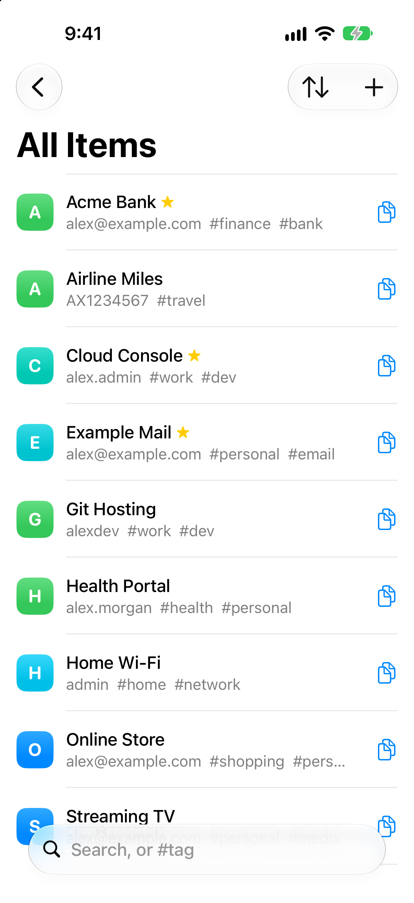
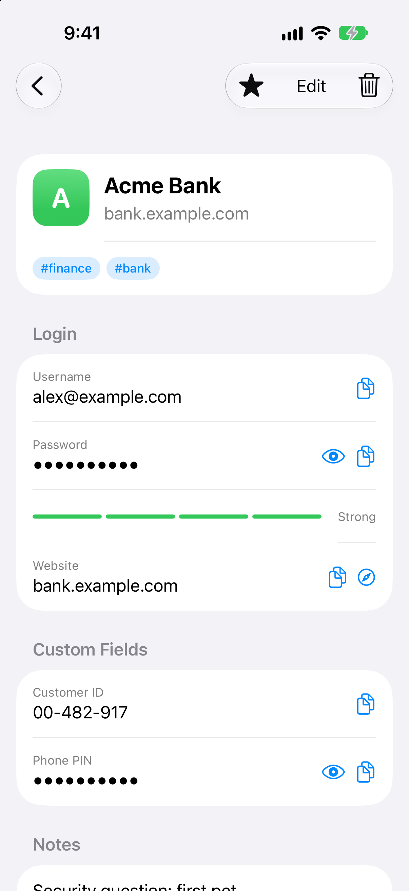
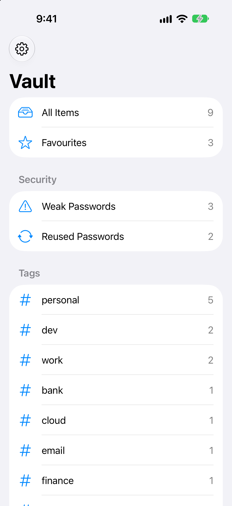
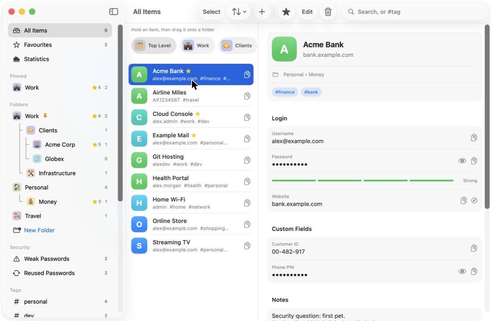

# Password Manager for iPhone, iPad, Mac and Apple Watch

Keep every login in one place, locked with Face ID or Touch ID and synced through your own iCloud account.

  
  
  

Screenshots are taken from the app running with sample data.

## What it does

- **One-tap copy** of a username or password, from the list or the detail screen. The clipboard clears itself.
- **Search** across titles, usernames, websites, notes and tags. Type `#` to filter by tag.
- **Sort** by title, date updated, date created, or favourites first.
- **Folders**, nested up to three levels, each with its own colour, emoji, star rating and optional pin. Drag items onto a folder, or tick several and move them together.
- **Hashtags** to organise logins, with a tag list in the sidebar.
- **Autocomplete**: your most used usernames and tags are one tap away, before you type anything.
- **Select All, Copy and Paste buttons** beside every field when adding or editing a login.
- **Password generator** with a strength meter.
- **Statistics**: charts of password strength, reuse, age, folders, tags and growth over time.
- **Security checks**: weak and reused passwords.
- **Previous passwords**: the last five are kept per login, and you can view, reuse, edit or delete them.
- **Drafts**: close the editor half-way and your typing is still there when you come back.
- **Custom fields** and file attachments on every item.
- **iCloud sync** across your iPhone, iPad, Mac and Apple Watch.
- **Encrypted backups** you can restore on any later version of the app.
- **AutoFill** in Safari and other apps.
- **Import** from Chrome, Safari, 1Password, Bitwarden and LastPass.
- **Text size** setting that makes everything in the app smaller or larger.
- **Trash** that keeps deleted items for 30 days.

## Guides

- [User guide](docs/user-guide.md)
- [Sync, backup and restore](docs/backup-and-sync.md)
- [Questions and answers](docs/faq.md)

## Requirements

iOS 17, iPadOS 17, macOS 14 or watchOS 10, or later.
