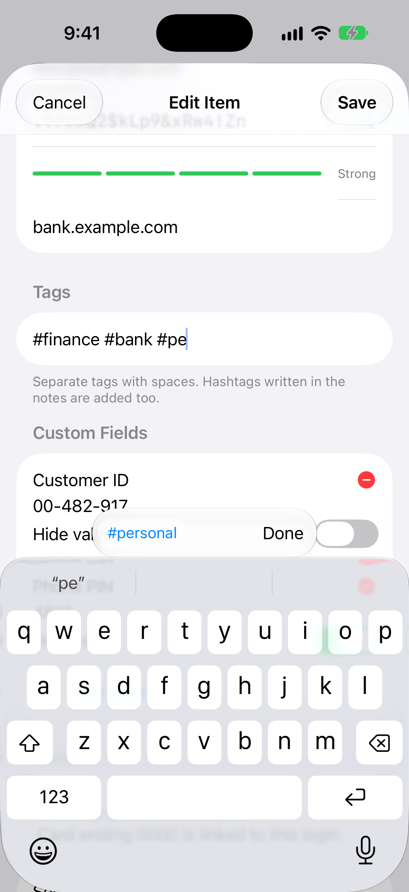
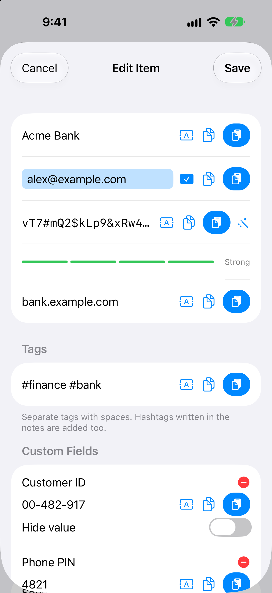
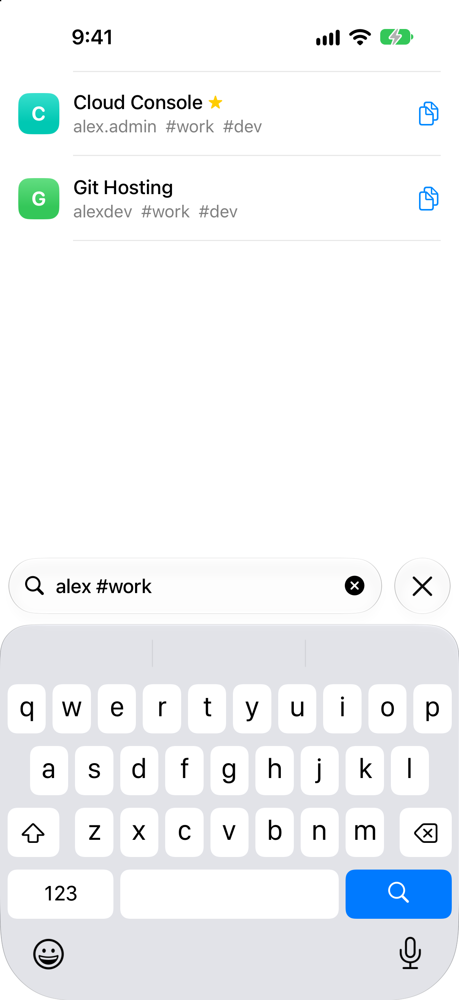
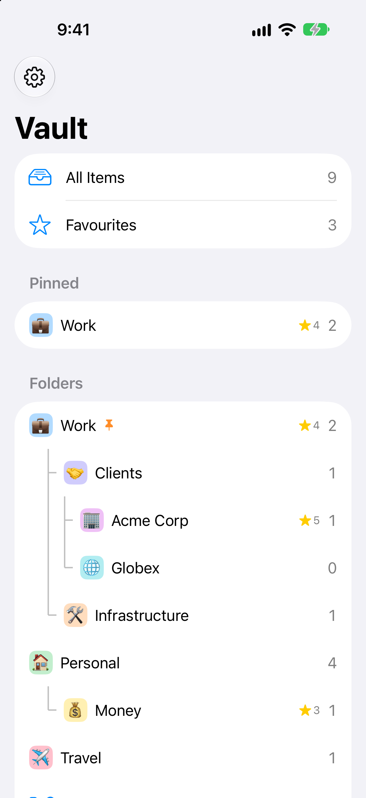
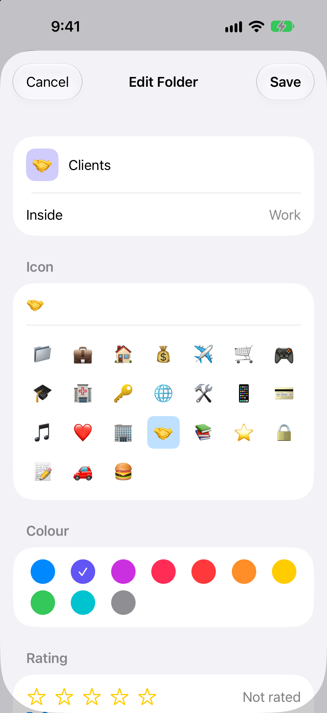
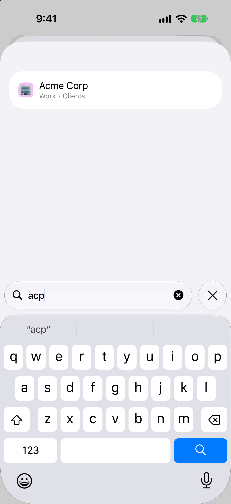
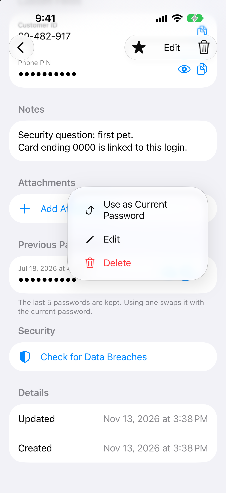

# User guide

## Unlocking

The app opens locked. Unlock with Face ID, Touch ID, or your device passcode. It locks again after it has been in the background for the time set in **Settings › Auto-Lock** (one minute by default).

## Adding a login

1. Tap **+**.
2. Enter a title, username, password and website. Only the title is required.
3. Tap the wand to generate a strong password.
4. Add tags, then tap **Save**.

### Autocomplete

Tap the username or tags field and your most used usernames and tags appear above the keyboard straight away. Tap one to fill it in. Start typing to narrow the list; titles and websites are suggested as you type too.

### Select All, Copy and Paste

Every field has three buttons beside it:

- **Select All** marks the whole field with a coloured, rounded box. Tap it again, or edit the text, to clear it.
- **Copy** copies the field's text.
- **Paste** drops in whatever you last copied. For tags and notes, the pasted text is added to what is already there.

### Unfinished edits are kept

If you close the editor without saving (Cancel, Escape on a Mac, or quitting the app), what you typed is kept on that device and is there when you open the editor again. To throw it away, scroll to the bottom and tap **Discard Changes**.

## Copying

- In the list, tap the copy icon on a row to copy its password.
- Swipe a row to the right for **Copy Password** and **Copy Username**.
- On the detail screen, every field has its own copy button.

Copied values stay on this device only and are cleared after one minute. Change the delay in **Settings › Clear Clipboard**.

## Searching and sorting

- Type any text to search titles, usernames, websites, notes and tags.
- Type `#` followed by a few letters to filter by tag. `alex #work` finds logins that contain "alex" and have the tag `work`.
- Tap the sort button to order by title, date updated, date created, or favourites first.

## Folders

Folders group your items and nest up to three levels deep. Lines in the sidebar join each subfolder to its parent. Selecting a folder shows its items and those of its subfolders.

- **Create**: tap **New Folder** at the end of the Folders list. For a subfolder, touch and hold a folder (right-click on a Mac) and choose **New Subfolder**.
- **Colour and emoji**: pick both when creating or editing a folder.
- **Star rating**: rate a folder from one to five stars in the editor, or from its menu.
- **Pin**: pinned folders appear in a **Pinned** section at the top and sort first among their siblings. Swipe a folder to the right, or use its menu.
- **Edit or delete**: swipe a folder to the left, or use its menu. Deleting a folder also deletes its subfolders, but the items inside are kept and move to the top level.

### Putting an item in a folder

In the item editor, tap **Folder**. Choose **No Folder (top level)** to keep the item outside every folder, or search for a folder. The search is forgiving: typing `acp` finds "Acme Corp". A new item starts in whichever folder you were viewing.

An item with just a title and notes works as a secure note, so folders can hold notes as well as logins.

## Tags

Type tags in the **Tags** field separated by spaces: `#work #bank`. Hashtags written in the notes are added as tags too. The sidebar lists every tag with its number of logins.

## Custom fields, attachments and history

- **Custom fields** hold anything extra, such as a customer number or PIN. Turn on **Hide value** to mask a field.
- **Attachments** store small files (up to 10 MB each) with a login.
- **Previous passwords**: the last five passwords of each login are kept, with the date each was replaced. Reveal or copy any of them, or tap **⋯** to use one as the current password (the two swap places), edit it, or delete it.

Every login shows when it was created and last updated.

## Security checks

The sidebar lists **Weak Passwords** and **Reused Passwords**.

## Deleting

Deleted logins move to **Trash** and are removed for good after 30 days. Open Trash to restore one or delete it immediately.

## AutoFill

1. Open the system **Settings** app.
2. Go to **General › AutoFill & Passwords**.
3. Turn on **Password Manager**.

When a sign-in form appears, choose Password Manager, unlock, and pick the login.

## Apple Watch

The watch app lists your logins, favourites first. Tap one, then tap the password to reveal it. The watch is read-only; add and edit on your iPhone, iPad or Mac.

## Importing

1. Export your passwords as a CSV file from your browser or old password manager.
2. Open **Settings › Import CSV…** and choose the file.
3. Delete the CSV file afterwards. It is not encrypted.

Logins already in your vault are skipped, so importing the same file twice does not create duplicates.

